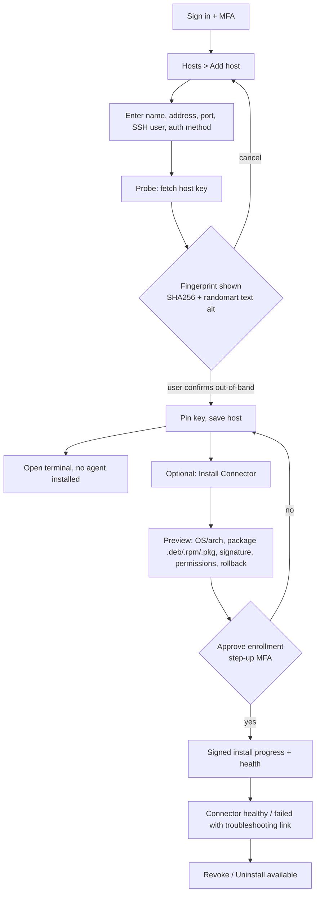
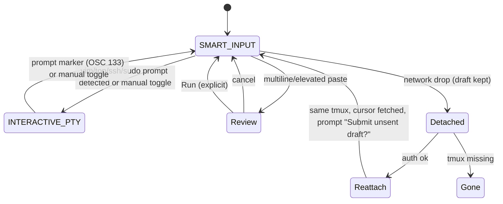
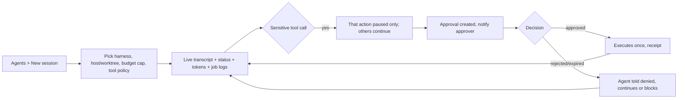

# UX flows

## F1 Host onboarding (PRODUCT journey 1, 2)

Errors: key mismatch later shows blocking `Key changed` screen with no "continue anyway" for non-admins; admin path requires reason + audit. Credentials are entered only in a POST form, never echoed or put in URLs.

## F2 Terminal + Command Studio (journey 3, WARP spec)

Rules shown in UI: one writer lease; spectators see read-only banner with "Request takeover" (audited). Queued keystrokes are never replayed. Mode indicator is text ("Smart" / "Raw") plus icon and announced.

## F3 Agent session (journey 5)

Agent pane never shows approve controls inline for the requester's own approval (separation of duties); it links to the inbox.

## F4 Approval inbox on mobile (journey 6)
```mermaid
sequenceDiagram
  participant N as Phone notification (no secrets)
  participant P as PWA (HTTPS)
  participant S as Server
  N->>P: tap deep link /approvals/{id}
  P->>S: session valid?
  alt not signed in
    P->>P: login (+MFA) then return to same id
  end
  P->>S: GET approval
  S-->>P: host, identity, exact command/diff, risk, rollback, requester, evidence, expiry
  P->>P: user reviews; Approve enabled after details rendered
  P->>S: Approve (step-up MFA challenge)
  S-->>P: result: Executed once / Failed / Expired
  S->>S: audit + receipt to Paperclip issue
```
Offline: inbox shows cached list marked `Stale - last updated hh:mm`; Approve/Reject disabled with reason "Needs connection". Delivery failure never auto-approves; expired approvals show `Expired` and cannot be actioned.

## F5 Host access request [DEP: Teleport CE has CLI-only requests]
User lacks access -> host card shows `No access` + "Request access" -> (CE) screen with request id and instructions for admin; (Enterprise/adapter) in-app status. Nexus approval ledger covers Nexus-mediated actions only and never implies SSH authorization. GitHub repo access is not shown as host access.

## F6 Audit view (journey 6, security)
Filter (time, actor, host, action, outcome, approval id) -> list of AuditRow -> detail drawer (immutable fields, correlation id, linked Paperclip issue, redacted output preview) -> export (requires permission, itself audited). Chain/integrity indicator text: `Verified` / `Gap detected`.

## F7 Reconnect (journey 3)
Banner states: Online -> `Connection lost` (editor stays editable, draft saved locally) -> `Reconnecting, attempt n, retry in Xs` (unlimited until user presses Stop) -> `Restored after mm:ss, same session`. Token expiry routes to login, then returns to the session.
