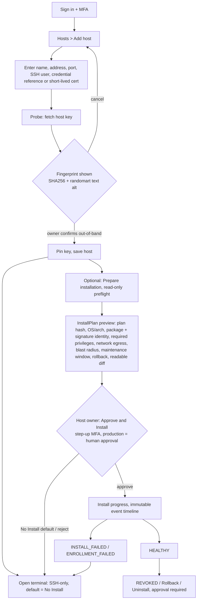
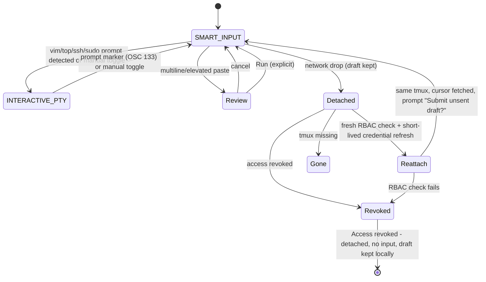
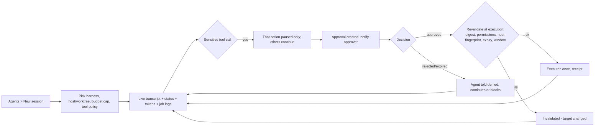

# UX flows

## F1 Host onboarding and connector install (PRODUCT journey 1, 2; CONNECTOR_INSTALL_APPROVAL.md)

- Credentials: the form takes a credential **reference** or short-lived SSH certificate. The browser never holds long-lived host private keys, and nothing secret is echoed or placed in a URL.
- Connector is optional. If install fails, the host stays usable over SSH-only; the failure is shown, never reported as healthy.
- Install event timeline (immutable, text list): `UNREGISTERED, SSH_VERIFIED, COMPATIBILITY_PROBED, PLAN_READY, AWAITING_APPROVAL, APPROVED, BOOTSTRAPPING, SIGNED_BINARY_VERIFIED, INSTALLED, ENROLLED, HEALTHY` plus `INSTALL_FAILED`, `ENROLLMENT_FAILED`, `REVOKED`, each with time, actor and redacted log link.
- Package option labels: Linux `.deb`/`.rpm`; macOS `.pkg` **[DEP I-3: macOS connector ship date open in EZF-2 plan section 3; shown as "Not yet available" until resolved]**.
- Approver is the **host owner**, not the requester. Staging may use an explicit scoped delegated approval; production requires human approval.
- **Key changed (later reconnect):** screen `Key changed - blocked` for **everyone, including admins**. There is no "continue anyway" and no one-time bypass. The only way out: fresh out-of-band owner verification of the new fingerprint, then re-pin with step-up MFA; the old and new fingerprints and the actor are audited.

## F2 Terminal + Command Studio (journey 3, WARP spec)

Rules shown in UI: one writer lease; spectators see read-only banner with "Request takeover". Takeover needs **approval from the current lease holder or the session owner** and is audited; a request alone never moves input. Observers are re-authorized (role recheck) on each join. Revocation (offboarding, suspended member, lost role) ends access to a live session immediately with `Access revoked - detached`; the tmux session itself is not killed by the UI. Queued keystrokes are never replayed. Mode indicator is text ("Smart" / "Raw") plus icon and announced.

## F3 Agent session (journey 5)

Agent pane never shows approve controls inline for the requester's own approval (separation of duties); it links to the inbox.

## F4 Approval inbox on mobile (journey 6)
```mermaid
sequenceDiagram
  participant N as Phone notification (no secrets)
  participant P as PWA (HTTPS)
  participant S as Server
  N->>P: tap deep link /approvals/{id}
  P->>S: session valid?
  alt not signed in
    P->>P: login (+MFA) then return to same id
  end
  P->>S: GET approval
  S-->>P: host, identity, exact command/diff, request digest, risk, rollback, requester, evidence, expiry, approvals 0/1 or 0/2
  P->>P: user reviews; Approve enabled after details rendered
  P->>S: Approve (step-up MFA challenge)
  S-->>P: result: Executed once / Failed / Expired
  S->>S: audit + receipt to Paperclip issue
```
Variants of the detail screen: (a) **production dual approval** shows `Awaiting second approver (1 of 2)` and the first approver's name; two distinct humans are required and the first cannot approve twice; (b) **own request**: the requester sees the same detail read-only, Approve/Reject replaced by the text `You can't approve your own request`; (c) **Invalidated - target changed**: at execution the digest or host fingerprint failed revalidation, nothing ran, the screen shows what changed and offers "Create new request". Approval of a plan never equals execution.

Offline: inbox shows cached list marked `Stale - last updated hh:mm`; Approve/Reject disabled with reason "Needs connection". Delivery failure never auto-approves; expired approvals show `Expired` and cannot be actioned.

## F5 Host access request [DEP: Teleport CE has CLI-only requests]
User lacks access -> host card shows `No access` + "Request access" -> (CE) screen with request id and instructions for admin; (Enterprise/adapter) in-app status. Nexus approval ledger covers Nexus-mediated actions only and never implies SSH authorization. GitHub repo access is not shown as host access.

## F6 Audit view (journey 6, security)
Filter (time, actor, host, action, outcome, approval id) -> list of AuditRow -> detail drawer (immutable fields, correlation id, linked Paperclip issue, redacted output preview) -> export (requires permission, itself audited). Chain/integrity indicator text: `Verified` / `Gap detected`.

## F7 Reconnect (journey 3)
Banner states: Online -> `Connection lost` (editor stays editable, draft saved locally) -> `Reconnecting, attempt n, retry in Xs` (unlimited until user presses Stop) -> `Restored after mm:ss, same session`. Token expiry routes to login, then returns to the session.
